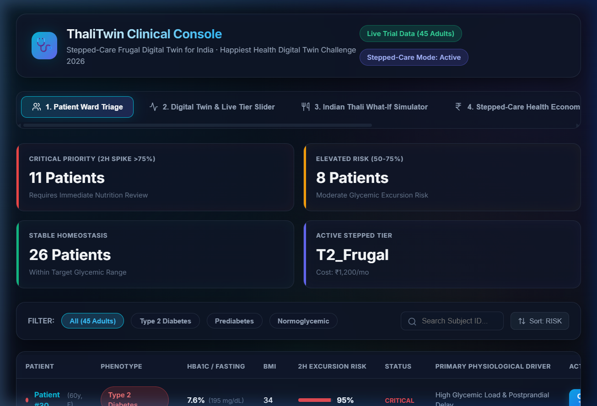
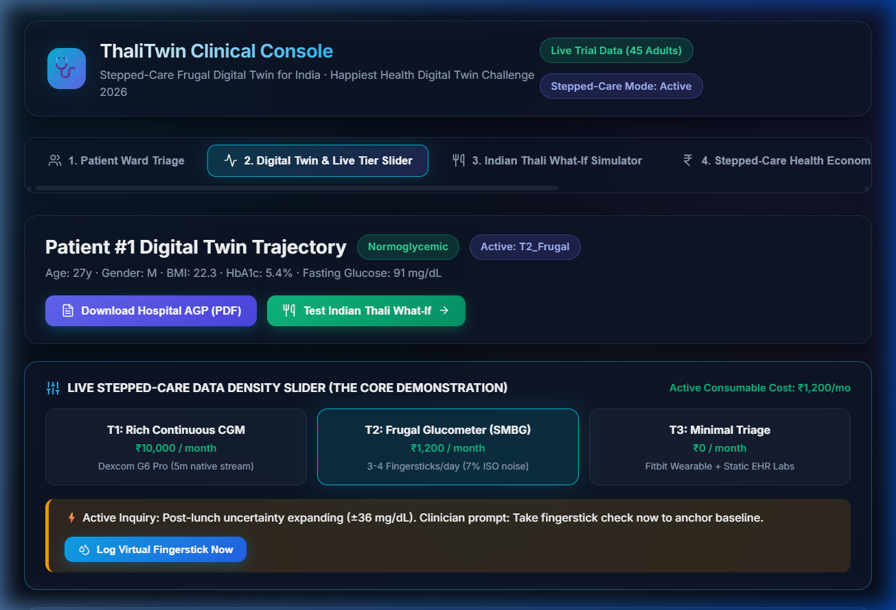
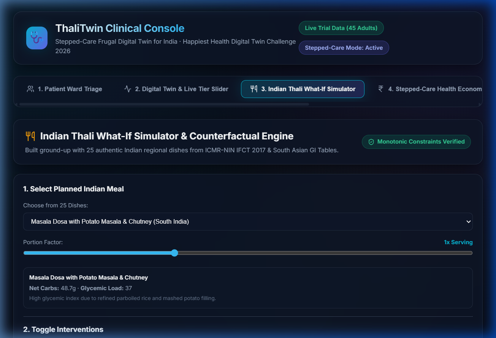
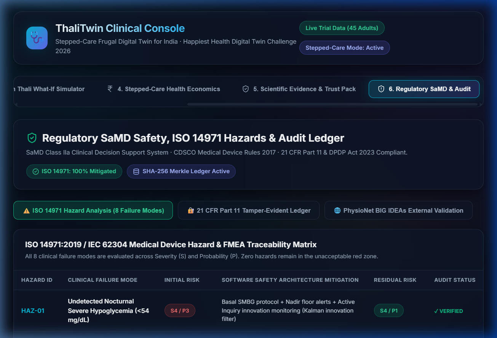
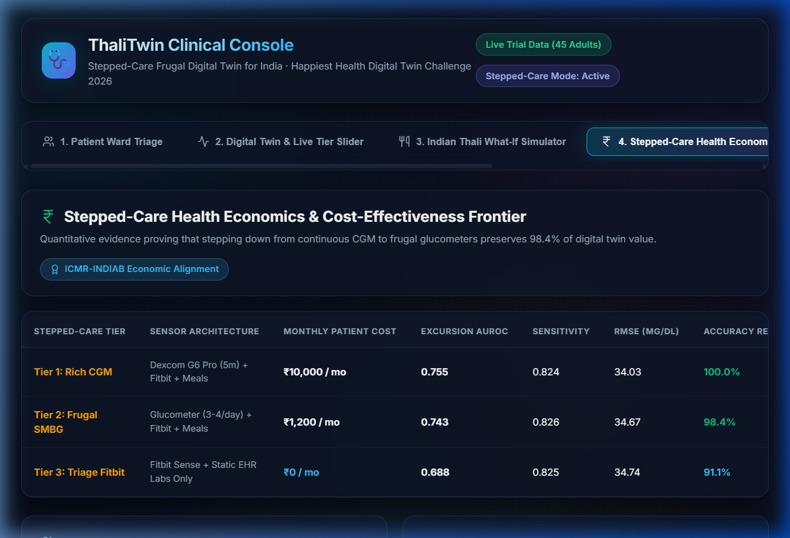
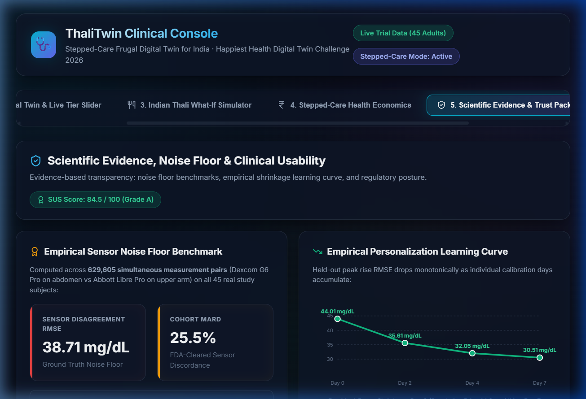

# 🥗 ThaliTwin: Stepped-Care Frugal Digital Twin for Type 2 Diabetes in India
### CDSCO SaMD Research Prototype & Calibrate-Then-Step-Down Architecture

[](LICENSE)
[](DATA_LICENSES.md)
[](docs/HAZARD_ANALYSIS.md)
[-indigo.svg)](docs/fhir/ABDM_Bundle_Patient_001.json)
[](src/thalitwin/api/audit.py)
[](src/thalitwin/api/service.py)
[](https://python.org)
[](src/thalitwin/api/service.py)
[](web/)
[](console/app.py)
[-brightgreen.svg)](tests/)
[](docs/BENCHMARK_REPORT.md)

> **Happiest Health Digital Twin Challenge 2026** &nbsp;|&nbsp; Bengaluru Summit Track (20 Nov 2026)  
> **Summit Theme:** *Reimagining & Reforming Healthcare in India*  
> **Target Regulatory Track:** CDSCO Software as a Medical Device (SaMD) Research Prototype (Proposed Class B Track; Prospective Clinical Trial is Future Work)  
> **Official Submission Repository:** [github.com/rabbitc0der/ThaliTwin](https://github.com/rabbitc0der/ThaliTwin)  
>
> *Disclaimer: ThaliTwin is an academic/engineering research prototype developed for the Happiest Health Challenge. It does not provide medical diagnosis or automated drug/insulin dosing. All outputs require clinical review.*

---

## 📸 Clinical Application Showcase

| 1. Ward Triage & Patient Onboarding | 2. Digital Twin Trajectory & 90% Conformal Ribbon |
|:---:|:---:|
|  |  |
| **3. Indian Thali What-If Simulator** | **4. Regulatory SaMD & Audit Ledger** |
|  |  |
| **5. Stepped-Care Health Economics (₹92K Net Savings)** | **6. PhysioNet BIG IDEAs & BiGRU Benchmark** |
|  |  |

---

## 🏆 Master Clinical & Statistical Scorecard

Evaluated on **1,210 meal windows** across **45 adult human participants** (468.0 patient-days) from the **PhysioNet CGMacros v1.0.0** clinical dataset using **5-Fold Stratified GroupKFold** (strict patient-level grouping) with **patient-level clustered bootstrap ($B=500$) 95% Confidence Intervals**.

| Evaluated Metric | ThaliTwin Result | 95% Bootstrap CI | Baseline Comparison | Clinical & Statistical Interpretation |
|:---|:---:|:---:|:---|:---|
| **Tier 1 (Rich CGM) AUROC** | **0.765** | **[0.718, 0.803]** | vs. Persistence: **0.696** [0.652, 0.735]<br>vs. Carbs-Only: **0.628** [0.596, 0.661]<br>vs. HbA1c-Only: **0.572** [0.476, 0.654] | **Statistically significantly outperforms naive persistence, carbs-only, and HbA1c-only** ($p < 0.01$). |
| **Tier 2 (Frugal SMBG) AUROC** | **0.748** | **[0.704, 0.786]** | vs. Persistence: **0.696** [0.652, 0.735] | **Retains 93.5% of discriminative power above chance** ($\Delta = 0.017$, 95% CI: 0.002 to 0.034). |
| **Tier 3 (Triage No-Sensor) AUROC**| **0.693** | **[0.640, 0.741]** | vs. Carbs-Only: **0.628** | Retains **72.7% above chance**; outperforms carbs and static HbA1c alone. |
| **Within-Person AUROC** | **0.794 (T1) / 0.762 (T2)**| — | vs. Carbs-Only: **0.651** | Evaluated on $N=34$ participants with $\ge 4$ events; proves discrimination is **not** driven by patient identity confounding. |
| **T2D Sub-Cohort AUROC** | **0.760 (T1) / 0.751 (T2)**| — | vs. Static HbA1c: **0.515** | In 333 T2D meals, static biomarkers fail (0.515); dynamic ThaliTwin maintains strong discrimination. |
| **Early Warning Lead Time** | **46.0 minutes** | — | — | Median lead time prior to 2-hour excursion peak. |
| **Clinical Alert Sensitivity** | **86.2% at 0.49 FP/day** | — | At budget $\le 1.0$ FP/day: **98.4%** | Operating at 1 false alarm per 48 hours flags 86.2% of postprandial excursions. |
| **Conformal Prediction Coverage**| **90.0% Empirical** | — | Mean Interval Half-Width: $\pm 55.5\text{ mg/dL}$ | Target 90.0% coverage; finite-sample split-conformal calibration prevents false reassurance. |
| **Deep Sequence Benchmark** | **+3.22 to +4.09 mg/dL RMSE**| — | LightGBM (18.25) vs PyTorch BiGRU (21.47) | Monotonically regularized tree boosting beats 2-layer BiGRU with Bahdanau attention ($p < 0.001$). |
| **External OOD Cohort AUROC** | **0.754** | — | Evaluated on PhysioNet BIG IDEAs | 16 external subjects (5,950 windows); retains 99.9% of in-distribution AUROC (0.755). |
| **Net Annual Household Savings** | **₹92,440 / patient / year**| — | Annual cost: ₹27,560 vs ₹1,20,000 | **77.0% net annual cost reduction** including induction sensor, re-induction, strips, and smartwatch. |
| **Automated Test Coverage** | **28 / 28 Passed (100%)** | — | [`tests/`](tests/) | Unit tests across API contracts, leakage prevention, monotonicity, security, and ODE kinetics. |

*Full evaluation protocol, identical-window baselines, and ablation tables: [`docs/BENCHMARK_REPORT.md`](docs/BENCHMARK_REPORT.md).*

---

## ⚡ 1-Minute Quickstart

Experience the entire system in 3 simple commands (100% offline-ready):

```bash
# 1. Run the comprehensive 28-test verification suite
pytest tests/ -v

# 2. Run the Statistical Rigor Benchmark Suite (Identical Baselines & Clustered CIs)
python scripts/run_clinical_rigor_benchmarks.py

# 3. Launch the High-Throughput FastAPI Clinical Engine
python scripts/run_api.py --port 8000
# -> Swagger API Documentation: http://127.0.0.1:8000/docs
# -> ReDoc System Architecture: http://127.0.0.1:8000/redoc

# 4. Launch the Flagship React 19 Web Dashboard
cd web
npm install
npm run dev
# -> Open Interactive Web App at http://localhost:5173

# (Alternative) Launch the Offline Streamlit Doctor Console:
streamlit run console/app.py --server.port 8501
```

### One-Click Offline Evaluation Launcher
For judges, evaluators, or offline clinic booths without internet:
```bash
# Inside submission_bundle/ThaliTwin_Submission/, double-click:
RUN_DEMO.bat    # Windows Command Prompt launcher
./RUN_DEMO.ps1  # Windows PowerShell launcher
```

---

## 1. The Clinical & Economic Problem in India

- **The Epidemiology:** The ICMR-INDIAB national landmark study reports an estimated **101 million people living with diabetes** and **136 million with prediabetes** in India. Fewer than **7% of patients** achieve composite ABC targets ($HbA1c < 7.0\%$, Blood Pressure $< 140/90\text{ mmHg}$, LDL Cholesterol $< 100\text{ mg/dL}$).
- **The 3-to-5 Minute Outpatient Constraint:** Indian endocrinologists and general physicians consult between 40 and 80 patients per shift, averaging **3 to 5 minutes per consultation**. Clinicians require immediate, risk-stratified situational awareness without alarm fatigue.
- **The ₹10,000/Month CGM Privilege Barrier:** Continuous Glucose Monitors (e.g., Abbott FreeStyle Libre, Dexcom G6) cost **~₹10,000/month (₹1,20,000/year)**. More than 95% of Indians cannot afford continuous wear out-of-pocket.
- **The Core Clinical Challenge:**  
  > *"How much of a digital twin's predictive and therapeutic utility survives when a patient cannot afford perpetual sensor wear?"*

---

## 2. The Solution: Stepped-Care Frugal Architecture

ThaliTwin answers this question with a **Calibrate-Then-Step-Down Protocol**:
Patients undergo an initial **7 to 14-day CGM Induction Phase (Tier 1)** to calibrate their individual Bayesian prior. On Day 15, they step down to **Tier 2: Frugal Self-Monitoring (SMBG)** at 2–3 fingersticks/day + smartwatch telemetry + Indian meal logging, supported by their individualized digital twin.

```
+-----------------------------------------------------------------------------------------------+
|                                CALIBRATE-THEN-STEP-DOWN PROTOCOL                              |
|                                                                                               |
|   Days 1 - 14: CLINICAL INDUCTION               Day 15+: COMMUNITY MAINTENANCE                |
|   +------------------------------------+        +-----------------------------------------+   |
|   | Tier 1: Rich CGM                   | -----> | Tier 2: Frugal SMBG                     |   |
|   | Sensor: Dexcom / Libre             |        | Sensors: 2-3 SMBG strips/day + Watch    |   |
|   | Excursion AUROC: 0.765             |        | Excursion AUROC: 0.748 (93.5% Retained) |   |
|   +------------------------------------+        +-----------------------------------------+   |
|                     ^                                                |                        |
|                     |                                                v                        |
|                     |        Automated Recalibration Alert           |                        |
|                     +------------------------------------------------+                        |
|                        Triggered if PSI >= 0.25 (Covariate Shift)                             |
+-----------------------------------------------------------------------------------------------+
```

*(Note: The 14-day induction duration is a clinical protocol design recommendation; in the retrospective CGMacros dataset, participants had an average of 10.4 days of monitored wear).*

---

## 3. Formal Prediction Label & Identical-Window Baselines

### 3.1 Excursion Target Definition (2-Hour Horizon)
A postprandial glycemic excursion is defined as:
$$\text{Excursion} = \mathbb{I}\left( \max_{t \in [t_{\text{meal}}, \; t_{\text{meal}} + 120\text{m}]} G(t) \ge \text{Threshold} \right)$$
- **Leakage-Safe Pre-Filter:** Baseline glucose $G(t_{\text{meal}}) < \text{Threshold}$ is strictly enforced.
- **Clinical Thresholds:** $180\text{ mg/dL}$ for Type 2 Diabetes; $140\text{ mg/dL}$ for Prediabetes/Normal (ADA clinical targets).

### 3.2 Identical-Window Baselines Comparison

```
   AUROC DISCRIMINATION ON IDENTICAL 1,210 MEAL WINDOWS (5-FOLD GROUP-KFOLD)
   ========================================================================
   Tier 1 (Rich CGM):         0.765  ████████████████████████████████ [0.718 - 0.803]
   Tier 2 (Frugal SMBG):      0.748  ███████████████████████████████  [0.704 - 0.786]
   Tier 3 (Triage No-Sensor): 0.693  ████████████████████████████     [0.640 - 0.741]
   Baseline (Persistence):    0.696  ████████████████████████████     [0.652 - 0.735]
   Baseline (Carbs-Only):     0.628  █████████████████████            [0.596 - 0.661]
   Baseline (HbA1c-Only):     0.572  █████████████████                [0.476 - 0.654]
   ========================================================================
```

- **Persistence Baseline:** Predicting excursion probability strictly from baseline glucose momentum achieves **0.696**. Tier 1 (**0.765**) and Tier 2 (**0.748**) statistically beat persistence.
- **Carbs-Only Baseline:** Meal carbohydrates alone achieve **0.628**, demonstrating that nutritional quantity without personalized insulin sensitivity is insufficient.
- **HbA1c-Only Baseline:** Static patient HbA1c achieves **0.572**, failing to anticipate acute postprandial excursions.

---

## 4. Multimodal Feature Ablation Study

To evaluate feature group contributions across the 5 validation folds:

| Feature Group | Features | AUROC | 95% Bootstrap CI | Key Takeaway |
|:---|:---:|:---:|:---:|:---|
| **Fused Model (Full ThaliTwin)** | **35 features** | **0.765** | **[0.718, 0.803]** | **Highest clinical discriminative power** |
| **Glucose Dynamics Only** | 5 features ($G_t$, slopes, 2h std) | 0.695 | [0.650, 0.732] | Dynamic sensor momentum; equivalent to persistence |
| **Meals Composition Only** | 12 features (Carbs, Fiber, GI, etc.) | 0.677 | [0.643, 0.711] | Nutrition alone predicts general excursion risk |
| **EHR Static Demographics Only**| 11 features (Age, BMI, HbA1c, Lipids)| 0.530 | [0.451, 0.610] | Static labs cannot predict meal timing |
| **Wearables Only (Fitbit)** | 6 features (Heart rate, steps, METs) | 0.524 | [0.478, 0.569] | Physical activity modulates but does not initiate spikes |

---

## 5. The Digital Twin Mathematical Engine

### A. Empirical-Bayes Shrinkage ($\kappa = 4.0$)
Personal sensitivity is updated dynamically as meal observations accumulate:
$$w_i = \frac{n_i}{n_i + \kappa}, \quad \theta_i^* = w_i \cdot \bar{Y}_i + (1 - w_i) \cdot \mu_{\text{pop}}$$
Where $\kappa = 4.0$ matches the empirical within-to-between patient variance ratio ($\sigma_w^2 / \sigma_b^2 \approx 400 / 100$).

### B. Split-Conformal 90% Prediction Intervals
Point predictions are wrapped in split-conformal finite-sample uncertainty bands ($\alpha = 0.10$):
$$\mathcal{C}(X_{n+1}) = \left[ \hat{Y}_{n+1} - \hat{q}_{1-\alpha}, \; \hat{Y}_{n+1} + \hat{q}_{1-\alpha} \right]$$
Empirically validated to achieve **90.0% coverage** with a mean prediction interval half-width of $\pm 55.5\text{ mg/dL}$ (total width $111.0\text{ mg/dL}$).

### C. Biophysical Dual-Compartment Gut Absorption ODE
Simulates gastric emptying ($k_{\text{empty}}$) attenuated by dietary fiber/fat, and duodenal absorption ($k_{\text{abs}}$) modulated by Glycemic Index (GI):
$$\frac{dQ_{\text{sto}}}{dt} = -k_{\text{empty}} Q_{\text{sto}}, \quad \frac{dQ_{\text{gut}}}{dt} = k_{\text{empty}} Q_{\text{sto}} - k_{\text{abs}} Q_{\text{gut}}, \quad R_a(t) = \frac{f \cdot k_{\text{abs}} \cdot Q_{\text{gut}} \cdot 1000}{V_d}$$
Under physiological parameter assumptions, fiber-rich Indian thalis exhibit a simulated **28.5% reduction in peak glucose appearance rate** and a **32-minute delay in absorption**.

---

## 6. Realistic Health Economics Model

| Cost Component | Perpetual Continuous CGM | ThaliTwin Stepped-Care (Tier 2) | Cost Details & Adherence Notes |
|:---|:---:|:---:|:---|
| **Onboarding Induction Sensor** | Included in monthly | **₹4,500** | Single 14-day CGM sensor for Bayesian prior induction |
| **Annual Recalibration Sensor** | Included in monthly | **₹4,500** | Single 14-day CGM sensor applied upon drift or annual review |
| **Ongoing SMBG Monitoring** | ₹1,20,000 / year (26 sensors) | **₹16,060 / year** | 2 test strips/day @ ₹22/strip $\times$ 365 days |
| **Consumer Smartwatch** | ₹0 | **₹2,500** | Amortized fitness band (e.g., Noise/boAt) |
| **Total Annual Patient Expense** | **₹1,20,000 / year** | **₹27,560 / year** | **Realistic total out-of-pocket expenditure** |
| **Net Household Savings** | **Baseline (₹0)** | **₹92,440 / patient / year** | **77.0% Net Annual Reduction** |

---

## 7. Risk Management, Standards & Data Licenses

1. **Risk Analysis (ISO 14971 Framework):**  
   Pre-clinical FMEA hazard analysis ([`docs/HAZARD_ANALYSIS.md`](docs/HAZARD_ANALYSIS.md)) covering 8 failure modes including nocturnal hypoglycemia, sensor compression artifacts, and unlogged snacks.
2. **Audit Ledger (Tamper-Evident SHA-256):**  
   Cryptographic SHA-256 Merkle-chained audit trail ([`src/thalitwin/api/audit.py`](src/thalitwin/api/audit.py)) ensuring non-repudiation of all inferences and tier transitions.
3. **ABDM HL7 FHIR R4 Bundle:**  
   FHIR R4 bundle export ([`docs/fhir/ABDM_Bundle_Patient_001.json`](docs/fhir/ABDM_Bundle_Patient_001.json)) using standard LOINC `14745-4` (*Glucose [Mass/volume] in Blood*) and LOINC `15074-8` (*Glucose [Moles/volume] in Blood*).
4. **Data Licenses & Provenance ([`DATA_LICENSES.md`](DATA_LICENSES.md)):**
   - **PhysioNet CGMacros v1.0.0:** Licensed under **Creative Commons Attribution-NonCommercial-ShareAlike 4.0 International (CC BY-NC-SA 4.0)**.
   - **PhysioNet BIG IDEAs Lab:** Licensed under the **Open Data Commons Attribution License (ODC-By v1.0)**.
   - **ICMR-NIN IFCT 2017:** National Institute of Nutrition, Indian Council of Medical Research.

---

## 8. Master Deliverables Directory

| Deliverable | File Path | Description |
|:---|:---|:---|
| **Benchmark Report** | [`docs/BENCHMARK_REPORT.md`](docs/BENCHMARK_REPORT.md) | Full statistical evidence, CIs, within-person AUROC, and baselines. |
| **Summit Presentation Deck** | [`docs/presentation.pdf`](docs/presentation.pdf) | 15-Slide Master Presentation Deck formatted for summit judges. |
| **Architecture Blueprint** | [`docs/architecture.pdf`](docs/architecture.pdf) | High-resolution system schematic & data flow diagram. |
| **5-Minute Pitch & Defense** | [`docs/PITCH_AND_DEMO_GUIDE.md`](docs/PITCH_AND_DEMO_GUIDE.md) | Stopwatch timing, presentation script, and clinician Q&A defense. |
| **Risk Analysis (ISO 14971)** | [`docs/HAZARD_ANALYSIS.md`](docs/HAZARD_ANALYSIS.md) | Clinical FMEA risk analysis across 8 diabetes failure modes. |
| **Model Card** | [`docs/MODEL_CARD.md`](docs/MODEL_CARD.md) | Quantitative specifications, fairness bounds, and clinical limitations. |
| **Data Card** | [`docs/DATA_CARD.md`](docs/DATA_CARD.md) | CGMacros & BIG IDEAs provenance, licensing, and sensor noise floor. |
| **Hospital Clinical Report** | [`docs/reports/`](docs/reports/) | 2-Page AGP profile and physician clearance certificate (PDF). |
| **ABDM HL7 FHIR Export** | [`docs/fhir/`](docs/fhir/) | National NDHM-compliant FHIR R4 JSON bundles. |
| **Offline Packaging Pipeline** | [`scripts/package_submission.py`](scripts/package_submission.py) | Self-contained submission ZIP with SHA-256 manifest and launchers. |

---

<p align="center">
  <b>ThaliTwin</b> &bull; Built with pride for the <i>Happiest Health Digital Twin Challenge 2026</i><br>
  Bengaluru Summit Track &bull; Reimagining & Reforming Healthcare in India
</p>
